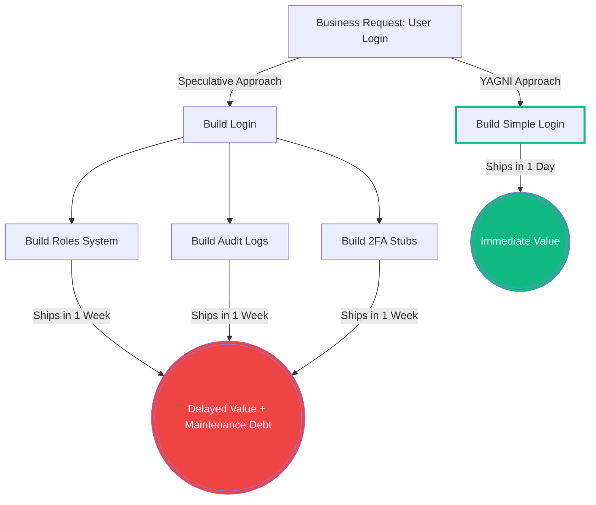

# YAGNI (You Aren't Gonna Need It)

> "Always implement things when you actually need them, never when you just foresee that you [will] need them." — Ron Jeffries, Extreme Programming co-founder

**YAGNI** (an acronym for *"You Aren't Gonna Need It"*) is a core principle arising from Extreme Programming (XP). It dictates that programmers should not add functionality, abstractions, or architecture until they are strictly deemed necessary by current business requirements.

---

## The Origins in Extreme Programming

YAGNI is the philosophical backbone of the XP practice known as **"Do the simplest thing that could possibly work"** (DTSTTCPW). 

XP advocates for short development cycles, continuous integration, and rapid refactoring. In this environment, writing code for *tomorrow's* speculative problems actively harms *today's* velocity. YAGNI works safely in XP because it is supported by a safety net of **continuous automated testing** and **continuous refactoring**. If you need the feature later, the test suite guarantees you can safely refactor the system to support it.

---

## The Cost of Speculative Design

When developers build a simple feature, they often try to anticipate future needs: *"We only need to fetch users today, but I'll build XML export, PDF generation hooks, and soft-delete capabilities just in case!"*

YAGNI explicitly forbids this due to the hidden costs of speculative code:

1. **The Maintenance Tax**: Every line of unused code must be compiled, tested, documented, and read by future developers.
2. **The Wrong Abstraction**: When you build a feature without a concrete, immediate requirement, you usually guess the API boundary incorrectly. When the business finally needs the feature, you must dismantle your old speculative code before writing the real code.
3. **Delayed Delivery**: Time spent building unused features is time stolen from delivering immediate value to the user.



---

## Code Smell: Premature Generalization

```ts
// ❌ Violates YAGNI (Speculative Design)
class UserService {
  // Building massive infrastructure for features that haven't been requested.
  getUser(id: string) { /* ... */ }
  exportUserToXML(id: string) { /* ... */ }
  generateUserReportPDF(id: string) { /* ... */ }
  softDeleteUser(id: string) { /* ... */ }
}
```

## The Solution: Focus on the Present

Only write what you need to solve the current requirement. Rely on clean, modular design to ensure the code remains easy to expand when future requirements arrive.

```ts
//  Adheres to YAGNI
class UserService {
  getUser(id: string) {
    // Only implement the actual, validated requirement
    return database.findUser(id);
  }
}
```

---

## Related Concepts

- **KISS (Keep It Simple, Stupid)**: Favor simplicity in the solution you are building today.
- **Minimum Viable Product (MVP)**: The business-level equivalent of YAGNI.
- **Technical Debt**: Without the supporting XP practice of continuous refactoring, YAGNI can theoretically lead to messy, disorganized code (technical debt) when features are forcefully bolted on later.
