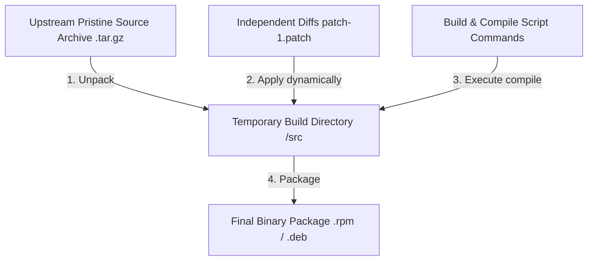

# Pristine Sources

> "The original, unmodified source code provided by upstream developers must be kept completely untouched by package maintainers." — Marc Ewing

**Pristine Sources** is a software packaging, version control, and release management philosophy. It dictates that the original, upstream source code archive (e.g., a `.tar.gz`, `.tar.bz2`, or `.zip` release) must remain completely untouched ("pristine") by package maintainers and downstream distribution developers. 

All packaging-specific adaptations—such as bug fixes, build script edits, security patches, or directory paths adjustments—must be managed as completely independent, separate **patch files** applied dynamically during the build process.

---

## 1. History and the Philosophy Behind RPM

The concept of Pristine Sources was originally coined in the mid-1990s by the developers of **Bogus Linux** (a pioneering but short-lived early Linux distribution). 

However, it was popularized and codified into a complete engineering philosophy by **Marc Ewing** (co-founder of Red Hat, Inc.) and **Erik Troan** as they developed the **RPM Package Manager (Red Hat Package Manager)**. This design decision was the single most important breakthrough that enabled Red Hat to build, update, and release their Red Hat Linux distribution faster and more reliably than any competitor of that era.

```
                         THE RED HAT RPM INSIGHT:
   ┌────────────────────────────────────────────────────────────────────────┐
   │ Problem:                                                               │
   │   Building an OS out of hundreds of open-source components, all        │
   │   upgrading on different, chaotic schedules across the Internet.       │
   │                                                                        │
   │ The Traditional Failure:                                               │
   │   Forking the components and hardcoding changes directly into the      │
   │   source code, making upgrades a nightmare.                            │
   │                                                                        │
   │ Ewing's Insight (Pristine Sources):                                    │
   │   "We cannot take responsibility for upstream code. Keep their source  │
   │   100% pristine, and isolate all our custom OS glue inside external    │
   │   declarative patch files."                                            │
   └────────────────────────────────────────────────────────────────────────┘
```

In a mid-1990s Red Hat manual, Ewing explained this core tenet in the classic section titled **"The Philosophy Behind RPM"**:
> Packagers must not take ownership or responsibility for the upstream source code itself. By utilizing RPM, Red Hat could build a package directly from the original, pristine upstream archive, applying a series of independent diffs at build time. This decoupled the OS distribution team from the rapid, independent release schedules of thousands of global open-source maintainers.

---

## 2. How It Works in Practice: The SPEC Workflow

Rather than modifying the upstream source repository directly, modern packaging systems (such as RPM `.spec` files, Debian `.debian.tar.xz` dirs, or Arch Linux `PKGBUILD` files) enforce a strict build-time separation:



### Example: A Minimal Red Hat SPEC File Structure
In an RPM SPEC configuration file, the packaging metadata is completely isolated from the raw source code:

```spec
Name:           example-app
Version:        2.4.1
Release:        1
Summary:        A sample application demonstrating Pristine Sources.
License:        MIT

# The pristine upstream source remains completely untouched!
Source0:        https://example.com/downloads/example-app-2.4.1.tar.gz

# Downstream patches are declared as independent files
Patch0:         fix-default-port.patch
Patch1:         add-security-hardening.patch

%prep
# Unpacks the pristine archive in a temporary build directory
%setup -q

# Applies the independent downstream patches sequentially
%patch0 -p1
%patch1 -p1

%build
# Compiles the newly patched source code
make %{?_smp_mflags}

%install
make install DESTDIR=%{buildroot}
```

---

## 3. Core Advantages of Pristine Sources

1. **Orthogonal Upgrades**: When an upstream project releases a new version (e.g., upgrading from `2.4.1` to `2.4.2`), the package maintainer simply updates the version number and swaps in the new pristine tarball. The package builder will automatically apply the existing patches. If a patch fails, only that specific, isolated patch needs to be refactored.
2. **Extreme Auditability and Transparency**: Downstream users, security teams, and auditors can easily inspect the package repository and see *exactly* what modifications the distribution maintainers introduced (via the raw `.patch` diffs), rather than trying to diff two massive, customized source code trees.
3. **Clean Collaboration with Upstream**: If a patch fixes a legitimate bug (such as a memory leak or buffer overflow), the package maintainer can easily send the isolated `.patch` file back to the upstream developers, closing the feedback loop and improving the entire ecosystem.
4. **No Git History Contamination**: Maintainers do not need to check millions of lines of external vendor code into their own Git repositories, keeping their version control light, fast, and focused solely on configuration and packaging logic.
