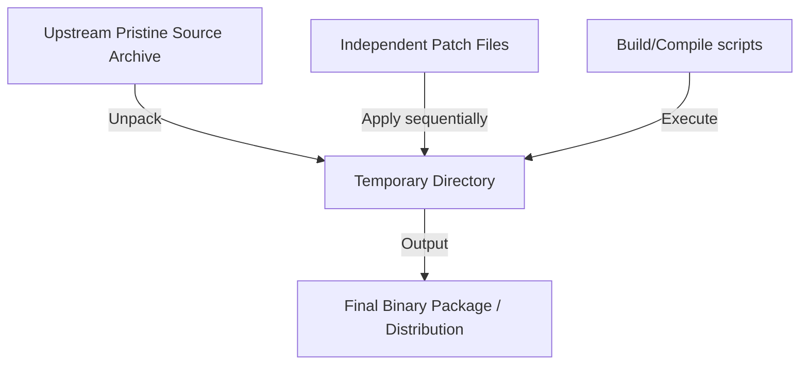

# Pristine Sources

> "The original, unmodified source code provided by upstream developers must be kept completely untouched by package maintainers."

**Pristine Sources** is a software packaging, version control, and release management philosophy. It dictates that the original, upstream source code archive (e.g., a `.tar.gz`, `.tar.bz2`, or `.zip` release) must remain completely untouched ("pristine") by package maintainers and downstream distribution developers. 

All packaging-specific adaptations—such as bug fixes, build script edits, security patches, or directory paths adjustments—must be managed as completely independent, separate **patch files** (e.g., `.patch` files) applied dynamically during the build process.

---

## Origins and Popularization

The concept was coined in the mid-1990s by the developers of **Bogus Linux** (a pioneering, short-lived early Linux distribution). 

It was quickly adopted and popularized by **Marc Ewing** (co-founder of Red Hat) and **Erik Troan** as a core, non-negotiable architectural design choice for the **RPM Package Manager** (Red Hat Package Manager). It has since become the gold standard for packaging systems across Debian, Arch Linux, Fedora, Homebrew, and other modern distribution managers.

---

## How It Works in Practice

Rather than modifying the upstream source repository directly, a packaging project follows this structured workflow:



1. **Keep the Base Tarball**: The packager imports the unmodified upstream tarball into the package source tree.
2. **Write External Patches**: Any necessary changes to compile on a specific target architecture (or to patch a security issue) are written as diff files:
   ```diff
   --- original/main.c
   +++ patched/main.c
   @@ -10,5 +10,5 @@
   -int port = 80;
   +int port = 8080;
   ```
3. **Sequential Automation**: During the build phase, the packaging tool automatically extracts the pristine upstream archive, applies all listed patch files in sequential order, and executes the compile commands.

---

## Core Advantages

1. **Orthogonal Upgrades**: When the upstream project releases a new version, the maintainer simply swaps in the new pristine archive. If the changes are orthogonal, existing patches apply automatically. If a patch fails to apply, only that specific patch needs to be adjusted.
2. **Auditability & Transparency**: Downstream users and security auditors can easily inspect the package repository and see *exactly* what modifications the distribution maintainers introduced, rather than trying to diff two massive, customized source code trees.
3. **Clean Collaboration**: It creates a clear division of labor: the original project owns the pristine source; the packager owns the integration patches.
