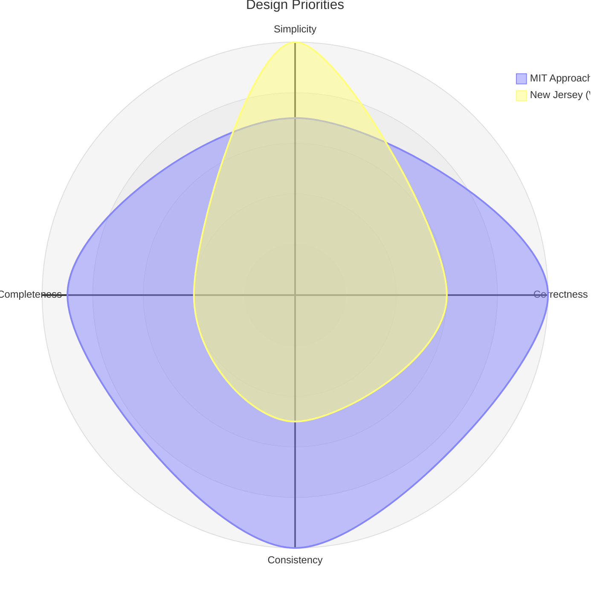

# Worse is Better

<CoverImage src="/covers/laws/worse-is-better.webp" alt="Worse is Better">
  <h1>Worse is Better</h1>
  
A small, slightly scruffy sailboat with a happy robot crew already sailing out of the harbour, while a magnificent unfinished golden galleon is still under construction on the dock.

</CoverImage>

> "Simplicity of both the interface and the implementation is more important than any other attribute of the system — including correctness, consistency, and completeness." — Richard P. Gabriel

**Worse is Better** (also known as the **New Jersey style**) is a conceptual model of software design formulated by Lisp programmer Richard P. Gabriel in his 1989 essay *"Lisp: Good News, Bad News, How to Win Big"*. It proposes a provocative idea: software that is limited but extremely simple to implement will ultimately outcompete and outlive software that is highly functional but complex.

---

## The Two Coasts of Software Philosophy

Gabriel argued that there was a conceptual split in software development, framing it as an ideological battle between two "coasts" of the United States.

### 1. The MIT Approach (The Right Thing / East Coast)

This approach strives for architectural purity. 
- **Simplicity**: Interface simplicity is paramount. Implementation simplicity is secondary.
- **Correctness**: Absolute correctness is a strict requirement. Incorrectness is simply not allowed.
- **Consistency**: Absolute consistency is mandatory, even at the cost of simplicity.
- **Completeness**: The design must cover as many important situations as practical.

### 2. The New Jersey Approach (Worse is Better / West Coast)

This approach strives for rapid implementation and deployment.
- **Simplicity**: **Implementation simplicity** is the single highest goal. The interface should also be simple, but the implementation comes first.
- **Correctness**: Correctness is a goal, but it is better to be simple than 100% correct if correctness requires massive implementation complexity.
- **Consistency**: Consistency can be sacrificed for simplicity.
- **Completeness**: Completeness must be sacrificed whenever implementation simplicity is jeopardized.

---

## Why "Worse" Wins the Market

Gabriel ironically coined the term as a caricature, initially intending to defend "The Right Thing" (the Lisp philosophy). However, he conceded that the "Worse is Better" approach has massively superior evolutionary survival characteristics.

### 1. The Ultimate Computer Virus
Gabriel pointed to **Unix and C**, developed by Bell Labs (in New Jersey), as the ultimate examples of this philosophy. Because C was incredibly simple to implement (it didn't require complex compilers or massive runtimes), it was ported to every new machine almost instantly. Unix spread like a virus.

### 2. The Conditioning of the User
By the time the complex "Right Thing" is finally built, the "Worse" product has already saturated the market. Users become conditioned to expect less and adapt to the quirks of the simpler system.

### 3. Iterative Improvement
Once "Worse" spreads, an army of developers naturally flocks to it. They gradually improve its functionality over years until it becomes *"almost the right thing"*. (For example, C and Unix continuously evolved into highly stable, ubiquitous platforms, heavily influencing Linux and the Open Source movement).

> [!NOTE]
> In 2000, Gabriel revisited his essay with *"Worse Is Better Is Worse"*, and applied the concept to C++'s massive success in the object-oriented field, despite the existence of far more elegant OOP languages.

---

## Modern Pragmatic Takeaways

1. **Ship the MVP**: Do not spend years designing the perfect, flawless architecture. A simple, slightly incomplete system that ships today will beat a flawless system that ships next year.
2. **Prioritize Developer Ergonomics**: If a framework is incredibly easy to set up and run (implementation simplicity), developers will adopt it, even if it lacks advanced edge-case features.
3. **Embrace Evolution**: Launch a simple foundation, capture the market, and let organic user feedback drive the incremental march toward correctness and completeness.
